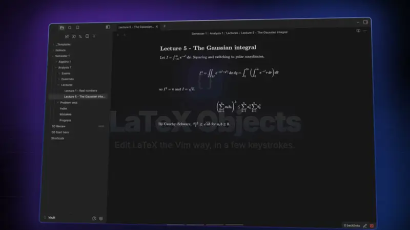
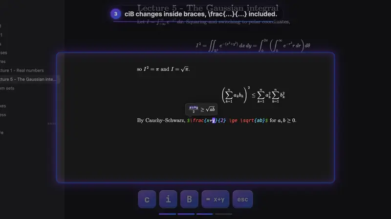
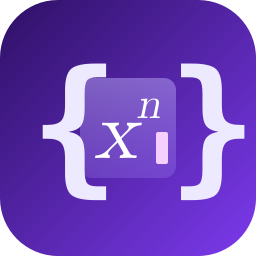

<p align="center">
  <b>Edit LaTeX in Obsidian the Vim way.</b><br>
  Change a matrix cell, delete an exponent, jump to the next environment or swap a fraction's arguments, in a few keystrokes.
</p>

<p align="center">
  <a href="https://community.obsidian.md/plugins/latex-objects"></a>
</p>

<p align="center">
  <a href="https://github.com/confuserdotcom/obsidian-latex-objects/releases/latest"></a>
  <a href="https://github.com/confuserdotcom/obsidian-latex-objects/releases"></a>
  <a href="https://github.com/confuserdotcom/obsidian-latex-objects/actions/workflows/test.yml"></a>
  <a href="https://github.com/confuserdotcom/obsidian-latex-objects/stargazers"></a>
  <a href="LICENSE"></a>
</p>

<p align="center">
  <a href="#text-objects">Text objects</a> ·
  <a href="#jumps">Jumps</a> ·
  <a href="#swap">Swap</a> ·
  <a href="#surround-with-vim-motions">Surround</a> ·
  <a href="#commands">Commands</a> ·
  <a href="#install">Install</a>
</p>

<p align="center">▶ <a href="docs/readme/demo.mp4"><b>Watch the full-quality video</b></a></p>

## At a glance

| You type | On | You get |
| --- | --- | --- |
| `ci&c` then Esc | `\begin{pmatrix} a & b \end{pmatrix}` (cursor on `b`) | `\begin{pmatrix} a & c \end{pmatrix}` |
| `da^` | `x^{n+1}` | `x` |
| `>,` | `\frac{a}{b}` | `\frac{b}{a}` |
| `dsb` | `\left( x \right)` | `x` |
| `csbB` | `\left( x \right)` | `\left\{ x \right\}` |
| `dim` | the line **before** `$$ … $$` | the maths emptied: objects seek the nearest one |
| `]e` `[e` | anywhere | the next / previous `\begin{…}` |

- **Knows LaTeX:** maths, environments matched by name, `\left \right` pairs, commands and their arguments, sub/superscripts, the cells and rows of `align` and `matrix`.
- **Knows Vim:** every operator (`d c y > gU …`), visual mode, counts and `.` repeat; each command is one undo step.
- **Works where you write:** Obsidian's built-in Vim or [Vim Motions](https://github.com/saberzero1/obsidian-vim-motions), callouts and blockquotes, desktop and mobile.

## How it works

They work with every operator (`d c y > gU …`), in visual mode, with counts and with `.` repeat. Every object **seeks**: it takes the one around the cursor, or else the closest one above or below. So `dim` works even when the cursor is on the line before the maths.

Requires Vim mode: Obsidian's built-in **Settings → Editor → Vim key bindings**, or the [Vim Motions](https://github.com/saberzero1/obsidian-vim-motions) plugin. The commands work without Vim.

## Text objects



| Keys | Object |
| --- | --- |
| `im` `am` | maths: `$…$` or `$$…$$` |
| `iM` `aM` | display maths `$$…$$` only (skips the inline maths on the way) |
| `ie` `ae` | environment `\begin{…} … \end{…}`, matched by name |
| `ib` `ab` | parentheses `( )`, `\left( \right)` |
| `iB` `aB` | braces `{ }`, `\{ \}`, `\left\{ \right\}` |
| `ir` `ar` | square brackets `[ ]`, `\left[ \right]`, and `⟦a; b⟧` intervals |
| `ic` `ac` | command `\frac{a}{b}`, `\sqrt[n]{x}`: `ic` is one argument (on the name: the first), `ac` the whole command |
| `i^` `a^` | superscript `x^{n+1}`, `x^2`, `x^\alpha` (in maths): `i^` is `n+1`, `a^` is `^{n+1}` |
| `i_` `a_` | subscript, the same with `_` |
| `i&` `a&` | cell of `align`, `pmatrix`, `cases`, `array` …: `i&` is its text, `a&` takes one `&` too, so `da&` leaves a clean row |
| `iR` `aR` | row of the same, up to `\\`: `aR` takes its `\\` (a row alone on its line: the line, like `dd`) |

`i` is the inside, `a` includes the delimiters. Put `n` or `l` in the middle for the **next** or **last** one: `dinm` deletes the inside of the next maths, `cilB` changes the inside of the previous braces.

- When the delimiters are on their own lines, the object is linewise, like Vim's `i{`: `dim` removes the lines, `cim` leaves one empty line to type on.
- In visual mode, repeating an object grows the selection to the enclosing one (`vie ie ie`). With a selection, `inB` / `ilB` step into the first / last block inside it.
- Counts: `3iB` is the 3rd enclosing braces; `3inB` / `3ilB` the 3rd next / previous at the same level (nested ones skipped). Too few → nothing happens, like Vim's `3i(`.
- `y`, `>`, `gU` … flash what they acted on for a moment, so you can see where a seek went.

## Jumps



| Keys | Jump to the next / previous |
| --- | --- |
| `]m` `[m` | maths |
| `]M` `[M` | display maths |
| `]e` `[e` | `\begin{…}` |
| `](` `[(` | `( )` |
| `]{` `[{` | `{ }` |
| `]c` `[c` | command with arguments |
| `]a` `[a` | argument: lands on its first character inside |
| `]C` `[C` | command by name: type it (Tab completes from the note, Esc cancels), then Enter |

They are motions: counts, operators (`d]m`) and visual mode work. After a jump, `;` repeats it and `,` goes the other way, until the next `f F t T`. `]C` `[C` work in normal and visual mode; `;` `,` repeat them too.

## Swap

- `>,` / `<,` swap the `{ }` argument under the cursor with the next / previous one of its command: `\frac{a}{b}` → `\frac{b}{a}`. On the name, the first argument moves. `[ ]` arguments stay.
- `>&` / `<&` do the same for the cell under the cursor in its row.
- The cursor goes along with the moved text; a count moves it further (`2>,`), and `.` repeats. `>>`, `>ap` and the other indents are unchanged; only `>,` / `<,` (indent to the last `f`/`t` target) are taken over.

## Matching

`%` on `\begin{…}` / `\end{…}`, `\left…` / `\right…` or a `$` / `$$` goes to its partner, from any character of the delimiter. `d%` deletes both delimiters and what is between them. Anywhere else, and after a count (`50%`), `%` is Vim's own.

While the cursor is on one of these delimiters, it and its partner are highlighted.

## Surround (with Vim Motions)

`ds` and `cs` on `b B r ( ) { } [ ]` seek the nearest bracket like `ib`, and know `\left \right`:

- `dsb` on `\left( x \right)` → `x`
- `csbB` on `\left( x \right)` → `\left\{ x \right\}`
- a `{ }` made inside maths is `\{ \}`, so it shows
- like vim-surround, an opening target (`ds(`) trims the spaces inside, and an opening replacement (`cs b (`) puts one space inside

`dsc` and `csc` work on the nearest command:

- `dsc` on `\mathbf{x}` → `x`; on `\frac{a}{b}` it keeps the argument under the cursor (on the name: the first)
- `csc` asks for the new name: `\mathbf{x}` → `\mathcal{x}`, and `.` repeats it with the same name

Other surround keys (`ys`, `ds"` …) stay Vim Motions' own.

## Commands

| Command | What it does |
| --- | --- |
| Unwrap maths | delete the `$` / `$$`, keep the maths |
| Delete maths with its `$` / `$$` | delete the maths and its lines when it is alone on them |
| Toggle inline / display maths | `$x$` ⇄ `$$x$$`; display → inline joins the lines and unwraps an inner `align` |
| Turn the maths under the cursor into align | `$$ \begin{align} … \end{align} $$`, `&` before the first relation of each line, `\\` between lines |
| Unwrap environment | delete `\begin` / `\end`, keep the content; `align`-type environments also lose their `&` and `\\` |
| Toggle environment star | `align` ⇄ `align*` |
| Rename environment | type the new name in `\begin{}`; leaving insert mode copies it to `\end{}` (one undo step). `align` → `gather` drops the `&`, → `alignat` adds `{n}` |
| Toggle `\left \right` on the nearest bracket | `( )` ⇄ `\left( \right)`, also `[ ]` and `\{ \}` |
| Delete command, keep its argument | the `dsc` equivalent, also for Obsidian's own Vim |
| Rename command | the `csc` equivalent, also for Obsidian's own Vim |
| Wrap in command | the selection (or the word under the cursor) → `\name{…}`, asking for the name |

The cursor stays on the character it was on. Every command is one undo step.

### vimrc

Bind the commands to keys in Settings → Hotkeys, or from a vimrc. With [Vim Motions](https://github.com/saberzero1/obsidian-vim-motions):

```vim
let mapleader = " "
nnoremap <leader>lm :obcommand latex-objects:unwrap-math<CR>
nnoremap <leader>ld :obcommand latex-objects:delete-math<CR>
nnoremap <leader>lt :obcommand latex-objects:toggle-math<CR>
nnoremap <leader>la :obcommand latex-objects:align-math<CR>
nnoremap <leader>le :obcommand latex-objects:unwrap-env<CR>
nnoremap <leader>lr :obcommand latex-objects:rename-env<CR>
nnoremap <leader>ls :obcommand latex-objects:star-env<CR>
nnoremap <leader>lb :obcommand latex-objects:size-bracket<CR>
nnoremap <leader>lx :obcommand latex-objects:delete-command<CR>
nnoremap <leader>lc :obcommand latex-objects:rename-command<CR>
nnoremap <leader>lw :obcommand latex-objects:wrap-command<CR>
vnoremap <leader>lw :obcommand latex-objects:wrap-command<CR>
```

With [Vimrc Support](https://github.com/esm7/obsidian-vimrc-support), wrap each command in an `exmap` first:

```vim
exmap unwrapmath obcommand latex-objects:unwrap-math
nmap <Space>lm :unwrapmath<CR>
```

## Settings

- **Seek distance**: how many lines away the nearest object is looked for (default 50, like mini.ai's `n_lines`). The one around the cursor is always found.
- **Jumps** and **Repeat jumps with ; and ,**: turn `]m [m …` and the `; ,` repeat off if they clash with your own maps.
- **Surround**: turn the `ds` / `cs` handling of brackets and commands off.
- **Match with %** and **Highlight matching delimiter**: turn `%` and the highlight off.
- **Flash** and **Flash duration**.

## What counts as maths

- `$$` pairs over the whole note; a `$$` that is not alone on its line only opens display maths if another `$$` closes it in the same paragraph.
- Inline `$…$` never spans lines.
- A backslash escapes the next character: `\$` is a dollar sign.
- `$` inside code fences and inline code is text.
- Blockquotes and callouts work: `> $$` is a delimiter on its own line.

## What counts as a command

- `\` and letters, inside maths. `\begin \end \left \right \middle \big …` are not commands: other objects own them.
- Its arguments are the `{…}` groups right after it, spaces and line breaks allowed between them. A `[…]` counts only when a `{…}` follows it: `\sqrt[n]{x}` has two, `\mathbb{R}[x]` one.
- Unbraced arguments (`\frac12`) are not arguments.
- `]C` finds commands without arguments too (`\alpha`); `ic` `ac` `]c` `]a` `dsc` `csc` skip them.

## Install

In Obsidian: **Settings → Community plugins → Browse**, search for **LaTeX Objects**, then install and enable it. Or open its page in the [community directory](https://community.obsidian.md/plugins/latex-objects) and select **Add to Obsidian**.

Then turn on Vim mode (**Settings → Editor → Vim key bindings**) or install [Vim Motions](https://github.com/saberzero1/obsidian-vim-motions).

Beta versions: add `confuserdotcom/obsidian-latex-objects` to [BRAT](https://github.com/TfTHacker/obsidian42-brat). By hand: download `main.js`, `manifest.json` and `styles.css` from the [latest release](https://github.com/confuserdotcom/obsidian-latex-objects/releases/latest) into `<vault>/.obsidian/plugins/latex-objects/`.

## Development

No build step: `main.js` is the plugin. To release, bump the version in `manifest.json`, `package.json` and `versions.json`, then push a tag equal to it (`git tag 1.2.0 && git push origin 1.2.0`): the release workflow tests, attests and publishes `main.js`, `manifest.json` and `styles.css`.

```sh
npm test          # unit tests + property tests on 1000 random notes
npm run lint      # Obsidian's own review rules (eslint-plugin-obsidianmd)
node fuzz.js 5000 # more random notes (a failure prints its seed to replay it)
node e2e.mjs      # real key presses in a running Obsidian (see the header of e2e.mjs)
```

The text objects, jumps and `%` hook into CodeMirror's Vim adapter (`window.CodeMirrorAdapter.Vim`), and with Vim Motions into its surround and config reload. Obsidian has no public API for Vim keys, so this is the only way in. Every patch is undone when the plugin is disabled.

## License

[MIT](LICENSE)

## Star history

<a href="https://star-history.com/#confuserdotcom/obsidian-latex-objects&Date">
  <picture>
    <source media="(prefers-color-scheme: dark)" srcset="https://api.star-history.com/svg?repos=confuserdotcom/obsidian-latex-objects&type=Date&theme=dark">
    
  </picture>
</a>

---

<p align="center">
  <br>
  If LaTeX Objects saves you keystrokes, <a href="https://github.com/confuserdotcom/obsidian-latex-objects">a ⭐ on GitHub</a> helps other Obsidian users find it.<br>
  Want to support it? <a href="https://confuserdotcom.lemonsqueezy.com">Support the plugin</a>.<br>
  Bugs and ideas: <a href="https://github.com/confuserdotcom/obsidian-latex-objects/issues">open an issue</a>.
</p>
