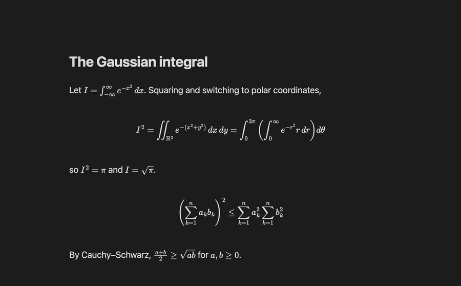

# LaTeX Objects

Vim text objects, jumps and editing commands for LaTeX in [Obsidian](https://obsidian.md): maths (`$…$`, `$$…$$`), environments (`\begin{…} … \end{…}`) and brackets (`( )`, `{ }`, `[ ]`, `\left( \right)`, `\{ \}`), and commands (`\frac{a}{b}`, `\sqrt[n]{x}`).



They work with every operator (`d c y > gU …`), in visual mode, with counts and with `.` repeat. Every object **seeks**: it takes the one around the cursor, or else the closest one above or below. So `dim` works even when the cursor is on the line before the maths.

Requires Vim mode: Obsidian's built-in **Settings → Editor → Vim key bindings**, or the [Vim Motions](https://github.com/saberzero1/obsidian-vim-motions) plugin. The commands work without Vim.

## Text objects

| Keys | Object |
| --- | --- |
| `im` `am` | maths: `$…$` or `$$…$$` |
| `iM` `aM` | display maths `$$…$$` only (skips the inline maths on the way) |
| `ie` `ae` | environment `\begin{…} … \end{…}`, matched by name |
| `ib` `ab` | parentheses `( )`, `\left( \right)` |
| `iB` `aB` | braces `{ }`, `\{ \}`, `\left\{ \right\}` |
| `ir` `ar` | square brackets `[ ]`, `\left[ \right]`, and `⟦a; b⟧` intervals |
| `ic` `ac` | command `\frac{a}{b}`, `\sqrt[n]{x}`: `ic` is one argument (on the name: the first), `ac` the whole command |

`i` is the inside, `a` includes the delimiters. Put `n` or `l` in the middle for the **next** or **last** one: `dinm` deletes the inside of the next maths, `cilB` changes the inside of the previous braces.

- When the delimiters are on their own lines, the object is linewise, like Vim's `i{`: `dim` removes the lines, `cim` leaves one empty line to type on.
- In visual mode, repeating an object grows the selection to the enclosing one (`vie ie ie`). With a selection, `inB` / `ilB` step into the first / last block inside it.
- Counts: `3iB` is the 3rd enclosing braces; `3inB` / `3ilB` the 3rd next / previous at the same level (nested ones skipped). Too few → nothing happens, like Vim's `3i(`.
- `y`, `>`, `gU` … flash what they acted on for a moment, so you can see where a seek went.

## Jumps

| Keys | Jump to the next / previous |
| --- | --- |
| `]m` `[m` | maths |
| `]M` `[M` | display maths |
| `]e` `[e` | `\begin{…}` |
| `](` `[(` | `( )` |
| `]{` `[{` | `{ }` |
| `]c` `[c` | command with arguments |
| `]a` `[a` | argument: lands on its first character inside |
| `]C` `[C` | command by name: type it (Tab completes from the note, Esc cancels), then Enter |

They are motions: counts, operators (`d]m`) and visual mode work. After a jump, `;` repeats it and `,` goes the other way, until the next `f F t T`. `]C` `[C` work in normal and visual mode; `;` `,` repeat them too.

## Matching

`%` on `\begin{…}` / `\end{…}`, `\left…` / `\right…` or a `$` / `$$` goes to its partner, from any character of the delimiter. `d%` deletes both delimiters and what is between them. Anywhere else, and after a count (`50%`), `%` is Vim's own.

While the cursor is on one of these delimiters, it and its partner are highlighted.

## Surround (with Vim Motions)

`ds` and `cs` on `b B r ( ) { } [ ]` seek the nearest bracket like `ib`, and know `\left \right`:

- `dsb` on `\left( x \right)` → `x`
- `csbB` on `\left( x \right)` → `\left\{ x \right\}`
- a `{ }` made inside maths is `\{ \}`, so it shows
- like vim-surround, an opening target (`ds(`) trims the spaces inside, and an opening replacement (`cs b (`) puts one space inside

`dsc` and `csc` work on the nearest command:

- `dsc` on `\mathbf{x}` → `x`; on `\frac{a}{b}` it keeps the argument under the cursor (on the name: the first)
- `csc` asks for the new name: `\mathbf{x}` → `\mathcal{x}`, and `.` repeats it with the same name

Other surround keys (`ys`, `ds"` …) stay Vim Motions' own.

## Commands

| Command | What it does |
| --- | --- |
| Unwrap maths | delete the `$` / `$$`, keep the maths |
| Delete maths with its `$` / `$$` | delete the maths and its lines when it is alone on them |
| Toggle inline / display maths | `$x$` ⇄ `$$x$$`; display → inline joins the lines and unwraps an inner `align` |
| Turn the maths under the cursor into align | `$$ \begin{align} … \end{align} $$`, `&` before the first relation of each line, `\\` between lines |
| Unwrap environment | delete `\begin` / `\end`, keep the content; `align`-type environments also lose their `&` and `\\` |
| Toggle environment star | `align` ⇄ `align*` |
| Rename environment | type the new name in `\begin{}`; leaving insert mode copies it to `\end{}` (one undo step). `align` → `gather` drops the `&`, → `alignat` adds `{n}` |
| Toggle `\left \right` on the nearest bracket | `( )` ⇄ `\left( \right)`, also `[ ]` and `\{ \}` |
| Delete command, keep its argument | `dsc`, for Obsidian's own Vim too |
| Rename command | `csc`, for Obsidian's own Vim too |
| Wrap in command | the selection (or the word under the cursor) → `\name{…}`, asking for the name |

The cursor stays on the character it was on. Every command is one undo step.

### vimrc

Bind the commands to keys in Settings → Hotkeys, or from a vimrc. With [Vim Motions](https://github.com/saberzero1/obsidian-vim-motions):

```vim
let mapleader = " "
nnoremap <leader>lm :obcommand latex-objects:unwrap-math<CR>
nnoremap <leader>ld :obcommand latex-objects:delete-math<CR>
nnoremap <leader>lt :obcommand latex-objects:toggle-math<CR>
nnoremap <leader>la :obcommand latex-objects:align-math<CR>
nnoremap <leader>le :obcommand latex-objects:unwrap-env<CR>
nnoremap <leader>lr :obcommand latex-objects:rename-env<CR>
nnoremap <leader>ls :obcommand latex-objects:star-env<CR>
nnoremap <leader>lb :obcommand latex-objects:size-bracket<CR>
nnoremap <leader>lx :obcommand latex-objects:delete-command<CR>
nnoremap <leader>lc :obcommand latex-objects:rename-command<CR>
nnoremap <leader>lw :obcommand latex-objects:wrap-command<CR>
vnoremap <leader>lw :obcommand latex-objects:wrap-command<CR>
```

With [Vimrc Support](https://github.com/esm7/obsidian-vimrc-support), wrap each command in an `exmap` first:

```vim
exmap unwrapmath obcommand latex-objects:unwrap-math
nmap <Space>lm :unwrapmath<CR>
```

## Settings

- **Seek distance**: how many lines away the nearest object is looked for (default 50, like mini.ai's `n_lines`). The one around the cursor is always found.
- **Jumps** and **Repeat jumps with ; and ,**: turn `]m [m …` and the `; ,` repeat off if they clash with your own maps.
- **Surround**: turn the `ds` / `cs` handling of brackets and commands off.
- **Match with %** and **Highlight matching delimiter**: turn `%` and the highlight off.
- **Flash** and **Flash duration**.

## What counts as maths

- `$$` pairs over the whole note; a `$$` that is not alone on its line only opens display maths if another `$$` closes it in the same paragraph.
- Inline `$…$` never spans lines.
- A backslash escapes the next character: `\$` is a dollar sign.
- `$` inside code fences and inline code is text.
- Blockquotes and callouts work: `> $$` is a delimiter on its own line.

## What counts as a command

- `\` and letters, inside maths. `\begin \end \left \right \middle \big …` are not commands: other objects own them.
- Its arguments are the `{…}` groups right after it, spaces and line breaks allowed between them. A `[…]` counts only when a `{…}` follows it: `\sqrt[n]{x}` has two, `\mathbb{R}[x]` one.
- Unbraced arguments (`\frac12`) are not arguments.
- `]C` finds commands without arguments too (`\alpha`); `ic` `ac` `]c` `]a` `dsc` `csc` skip them.

## Install

Until it is in the community plugins list, either:

- use [BRAT](https://github.com/TfTHacker/obsidian42-brat): add `confuserdotcom/obsidian-latex-objects`, or
- download `main.js`, `manifest.json` and `styles.css` from the [latest release](https://github.com/confuserdotcom/obsidian-latex-objects/releases/latest) into `<vault>/.obsidian/plugins/latex-objects/`, then enable **LaTeX Objects** in Settings → Community plugins.

## Development

No build step: `main.js` is the plugin.

```sh
npm test          # unit tests + property tests on 1000 random notes
node fuzz.js 5000 # more random notes (a failure prints its seed to replay it)
node e2e.mjs      # real key presses in a running Obsidian (see the header of e2e.mjs)
```

## License

[MIT](LICENSE)
